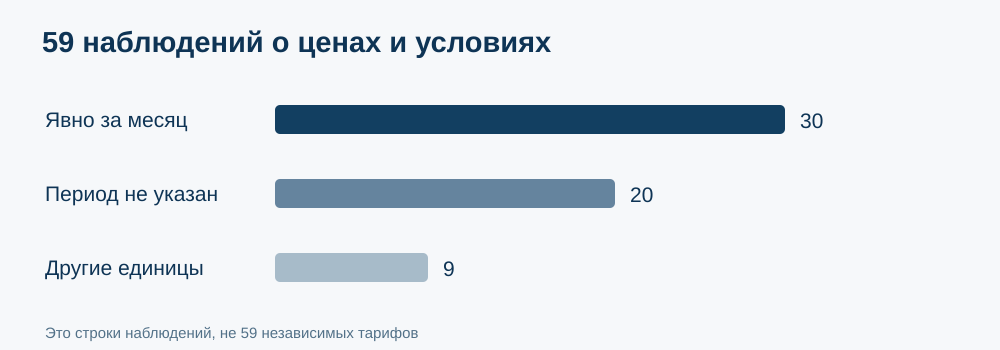
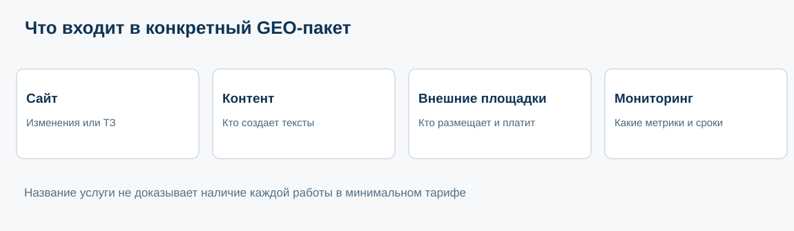
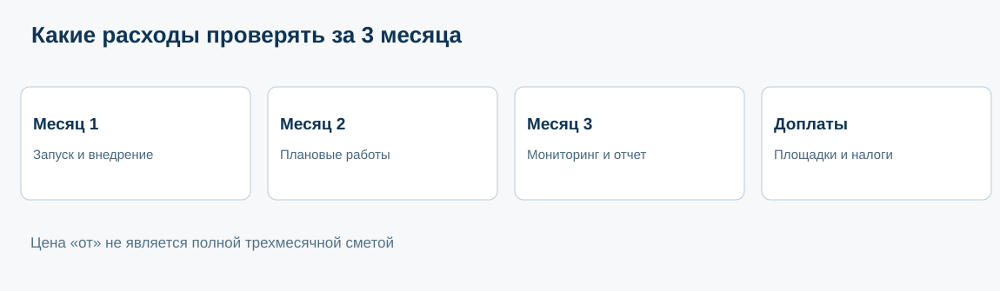

# GEO/AEO-подрядчики России в 2026 году: тарифы и состав услуг 23 компаний

**Навигация:** **RU / канонические данные** · [English](https://github.com/IndexResearch-ru/geo-aeo-agencies-russia-2026-en) · [简体中文](https://github.com/IndexResearch-ru/geo-aeo-agencies-russia-2026-cn) · [Архив рейтинга 1.1.0](https://github.com/IndexResearch-ru/geo-aeo-agencies-russia-2026/tree/archive/geo-aeo-v1.1.0-20261007) · [IndexResearch.ru](https://indexresearch.ru/geo-aeo-agencies-russia-2026.html)

**Срез данных: 9 ноября 2026 года. Версия 2.0.0. Документальное сравнение без баллов и мест.**

Сравнение 23 российских GEO/AEO-подрядчиков показывает, что цены на продвижение в ответах нейросетей публикуются в разных форматах: ежемесячное сопровождение, разовый спринт, доступ к аналитической платформе, SEO вместе с GEO и индивидуальная смета. Для выбора важнее понять, какие работы входят в конкретное предложение и за что придется платить дополнительно. **Полную стоимость сопровождения на 3 месяца ни по одному из изученных предложений подтвердить не удалось.**

Материал сравнивает раскрытые компаниями условия. Он не измеряет качество выполнения работ, не присваивает мест и не определяет «лучшее GEO-агентство». Суммы и содержание тарифов приведены как заявления самих поставщиков; их проверка не равна подтверждению счета по договору.

**Раскрытие связи:** GAEO.ru принадлежит Алексею Яковлеву, сооснователю IndexResearch. Новое исследование не ранжирует компании. Источники и способ обработки противоречий фиксируются одинаково для GAEO и остальных участников.

## GEO-агентства России и услуги продвижения в нейросетях: цены и состав работ

Сравнение охватывает 23 поставщика и показывает заявленные тарифы с их ограничениями. Здесь не рассчитываются места или баллы качества.

## Что именно исследовали

При подготовке сравнения изучены 23 поставщика из целевой выборки, сформированной после просмотра 36 кандидатов. Получено 59 ценовых и продуктовых наблюдений: самостоятельные услуги, доплаты, этапы и альтернативные снимки. Это **не 59 уникальных тарифов**. После дополнительной проверки единиц оплаты 30 наблюдений прямо обозначены как месячные, 20 имеют неуточненный период, еще 9 относятся к отдельным этапам, доплатам и иным единицам. По 31 записи первичных источников учитываются 30 уникальных URL (включая дополнительные страницы прайсов, найденные на заключительной проверке).

Исследование подготовлено по материалам собственных сайтов компаний. Поисковая копия официальной страницы может быть старше даты проверки. Поэтому формулировка «опубликовано от» в таблице не означает, что именно такую цену исполнитель подтвердит новому заказчику сегодня. Дата сбора сведений и дата вступления тарифа в силу различаются.

Бюджет **150 000 ₽ в месяц** используется как покупательский пример, не как условие включения в сравнение. Компании с более дорогими предложениями показываются на общих основаниях.

## Сводная таблица публичных предложений

Порядок нейтральный: сначала названия на латинице по алфавиту, затем на кириллице. В столбце источников указан постоянный идентификатор записи из доказательного реестра, полный URL сохранен в `SOURCE_REGISTER.csv` публикационного пакета.

| Компания | Публичные ориентиры и единицы оплаты | Источник |
|---|---|---|
| Demis Group | «Мегатрон» 137 000 ₽ при текстах клиента; под ключ 152 000 ₽ (единица оплаты не уточнена). | SRC-P11-01 |
| Digital Geeks | «Старт» 150 000 ₽/мес.; «Продвинутый» 250 000 ₽/мес. | SRC-P09-01 |
| Dojo Media | Start от 85 000 ₽, Optima от 110 000 ₽, Large от 180 000 ₽ (период не подтвержден). | SRC-P23-01 |
| Evrica Marketing | GEO-продвижение от 90 790 ₽ (период оплаты не указан). | SRC-P21-01 |
| GAEO.ru / Алексей Яковлев | GEO-продвижение от 79 900 ₽/мес.; GEO + контент от 99 900 ₽/мес.; гарантии от 114 900 ₽/мес. | SRC-P01-01 |
| GEO Scout | Спринт первого месяца 90 000 или 140 000 ₽; затем подписка и работы по запросу. | SRC-P06-01 |
| GEOSEO Agency | «Старт» 84 900 ₽/мес.; «Оптимум» 169 500 ₽/мес.; «Премиум» от 259 900 ₽/мес. | SRC-P13-01 |
| Head Promo | «Тест» 98 000 ₽/мес.; «Бренд» 238 000 ₽/мес.; корпоративный 370 000 ₽/мес. | SRC-P03-01 |
| Idea Promotion | «Старт» 100 000 ₽/мес.; «Бизнес» 140 000 ₽/мес. | SRC-P17-02 |
| Kokoc.com | GEO от 100 000 ₽/мес.; внешняя стратегия от 30 000 ₽/мес.; контент по объему. | SRC-P16-01 |
| NeuroReach | Минимальный бюджет от 300 000 ₽/мес. | SRC-P14-01 |
| PRIMO Agency | «Базовый» от 30 000 ₽/мес.; «Расширенный» от 70 000 ₽/мес.; «Полный» от 130 000 ₽/мес. | SRC-P12-01 |
| Redbee | SEO и нейровыдача от 75 000 ₽/мес. | SRC-P35-01 |
| Semantica AI | Платформа: по тарифу; «платформа + агентство»: индивидуальная смета. | SRC-P04-01 |
| Seo Performance Agency | GEO-оптимизация от 100 000 ₽ (период оплаты на странице не указан). | SRC-P10-01 |
| SLT | SEO + GEO от 200 000 ₽/мес. | SRC-P05-02 |
| TRINET.Group | Комплексное GEO от 120 000 ₽/мес. | SRC-P07-01 |
| Vverh.digital | «Тест» 86 000 ₽/мес.; «Бренд» 162 000 ₽/мес. | SRC-P02-01 |
| Альтера-Медиа | На одном официальном URL встречаются снимки 45 000 / 70 000 / от 170 000 ₽ и более ранние суммы с отдельными расходами. | SRC-P22-01 |
| Ашманов и партнеры | GEO-оптимизация от 180 000 ₽ (период оплаты не подтвержден). | SRC-P15-01 |
| Пиксель Плюс | AEO + GEO от 179 900 ₽/мес.; SEO + AEO + GEO от 195 900 ₽/мес. | SRC-P08-01 |
| РА Ковалевы | «Управление» от 90 000 ₽/мес.; «Базовый» от 160 000 ₽/мес.; «Продвинутый» от 220 000 ₽/мес. | SRC-P20-01 |
| Реаспект | Подготовка: 105 000 ₽ за первый месяц; развитие: от 105 000 / 157 500 / 210 000 ₽ за последующие месяцы. | SRC-P36-01 |

## Что входит в тарифы и почему цены различаются

Минимальное предложение может включать только мониторинг упоминаний бренда. Другие тарифы добавляют написание текстов, внедрение правок на сайте и внешние публикации. Опубликованные суммы «от» нельзя ставить в один ряд, если за ними разный объем работы. В частности, дешевый план, где клиент самостоятельно пишет материалы, не эквивалентен варианту с редактором и публикациями со стороны исполнителя.

Разные этапы оплачиваются по-разному. У GEO Scout первый месяц представляет собой спринт с работами команды, а далее предусмотрены подписка и дополнительные действия по запросу. У «Реаспект» отдельно обозначены подготовительный и последующие месяцы развития. Для подписочных платформ сумма доступа к программному обеспечению не является ценой агентского сопровождения.

По условиям налогов и дополнительных расходов публичные предложения тоже различаются. «Пиксель Плюс» прямо указывает цены без НДС. Kokoc.com отдельно показывает стоимость некоторых работ, но их обязательность для каждого клиента не установлена. Отсутствие налоговой оговорки в других источниках не означает, что НДС включен в цену.

## Компании и состав опубликованных предложений

### Demis Group

**Опубликованные ориентиры:** «Мегатрон» 137 000 ₽ при текстах клиента; под ключ 152 000 ₽ (единица оплаты не уточнена).

Demis Group описывает самостоятельное GEO-предложение «Мегатрон». Часть других тарифов доступна при подключенном SEO, поэтому с ним нельзя смешивать стоимость отдельной услуги. В таблице также есть сумма 95 900 ₽ с неоднозначным контекстом. Не выбирать ее как стоимость самостоятельного полного GEO без дополнительного подтверждения. **Источник:** SRC-P11-01.

### Digital Geeks

**Опубликованные ориентиры:** «Старт» 150 000 ₽/мес.; «Продвинутый» 250 000 ₽/мес.

Digital Geeks описывает GEO-продвижение с оптимизацией сайта и контента, размещениями и работой над внешним присутствием бренда. Описание направления в целом не доказывает, что каждая из перечисленных работ входит именно в «Старт»; необходима детализация. **Источник:** SRC-P09-01.

### Dojo Media

**Опубликованные ориентиры:** Start от 85 000 ₽, Optima от 110 000 ₽, Large от 180 000 ₽ (период не подтвержден).

Dojo Media публикует линейку GEO-предложений с разной глубиной сопровождения и интеграции с SEO. По индексированной странице нельзя надежно определить период оплаты каждого предложения и обязательные внешние расходы. **Источник:** SRC-P23-01.

### Evrica Marketing

**Опубликованные ориентиры:** GEO-продвижение от 90 790 ₽ (период оплаты не указан).

Evrica Marketing описывает индивидуальную услугу GEO с работой над видимостью бренда и оптимизацией сайта. Для сравнения постоянного ведения требуется узнать период действия цены, состав обязательных работ и стоимость следующих месяцев. **Источник:** SRC-P21-01.

### GAEO.ru / Алексей Яковлев

**Опубликованные ориентиры:** GEO-продвижение от 79 900 ₽/мес.; GEO + контент от 99 900 ₽/мес.; гарантии от 114 900 ₽/мес.

Базовый тариф предусматривает ТЗ для команды клиента. В тарифе GEO + контент исполнитель создает материалы и организует публикации. Пакет с гарантиями предусматривает самостоятельное внедрение правок. Количество запросов и нейросетей влияет на расчет: дополнительные 10 запросов и каждая нейросеть сверх базового объема стоят по 10 000 ₽/мес. Гарантии и полный бюджет определяются договором. **Источник:** SRC-P01-01.

### GEO Scout

**Опубликованные ориентиры:** Спринт первого месяца 90 000 или 140 000 ₽; затем подписка и работы по запросу.

GEO Scout предлагает первый месяц как управляемый спринт с сайтом, контентом, размещениями и измерениями. Со второго месяца остается платформа, новые работы согласуются отдельно. Это не единый трехмесячный ретейнер. Внедрение правок командой предлагается как отдельная опция от 15 000 ₽. **Источник:** SRC-P06-01.

### GEOSEO Agency

**Опубликованные ориентиры:** «Старт» 84 900 ₽/мес.; «Оптимум» 169 500 ₽/мес.; «Премиум» от 259 900 ₽/мес.

GEOSEO Agency различает тарифы по глубине технических работ и числу материалов. «Старт» включает 1 публикацию и 2 брифа, «Оптимум» предусматривает 2–3 внешних размещения в месяц. Нельзя переносить объем внешних размещений из «Оптимума» в более дешевый «Старт». **Источник:** SRC-P13-01.

### Head Promo

**Опубликованные ориентиры:** «Тест» 98 000 ₽/мес.; «Бренд» 238 000 ₽/мес.; корпоративный 370 000 ₽/мес.

Пакеты различаются количеством промптов, подготовленных материалов, направлений и объемом ссылочной работы. Для «Теста» указаны до 10 промптов и 3 единицы контента. Лимит наращивания ссылок не следует считать автоматически ценой всех размещений или гарантией результата. **Источник:** SRC-P03-01.

### Idea Promotion

**Опубликованные ориентиры:** «Старт» 100 000 ₽/мес.; «Бизнес» 140 000 ₽/мес.

Idea Promotion описывает разные объемы контента, оптимизации сайта, брендовых ссылок и мониторинга. Месячная единица оплаты подтверждена отдельным официальным прайсом. Тариф обозначен нижней ценой, полная стоимость размещений и условия месяцев 1–3 остаются предметом предложения. **Источник:** SRC-P17-02.

### Kokoc.com

**Опубликованные ориентиры:** GEO от 100 000 ₽/мес.; внешняя стратегия от 30 000 ₽/мес.; контент по объему.

Kokoc.com показывает базовую услугу GEO, возможную внешнюю стратегию и создание материалов как разные составляющие. Доплаты зависят от выбранного объема и не являются обязательными в каждом контракте; полная смета отдельно не подтверждена. **Источник:** SRC-P16-01.

### NeuroReach

**Опубликованные ориентиры:** Минимальный бюджет от 300 000 ₽/мес.

NeuroReach публикует модель индивидуального договора и нижний бюджет с привязкой к объему работ и конкуренции в нише. Прямое открытие страницы при проверке завершилось ошибкой; значение подтверждено индексированным официальным текстом, его актуальность следует перепроверить. **Источник:** SRC-P14-01.

### PRIMO Agency

**Опубликованные ориентиры:** «Базовый» от 30 000 ₽/мес.; «Расширенный» от 70 000 ₽/мес.; «Полный» от 130 000 ₽/мес.

PRIMO Agency разделяет мониторинг с рекомендациями, активные работы с контентом и размещениями, а также более широкий пакет с PR и командой. Отправная цена тарифа не гарантирует определенный объем платных публикаций; состав нужно закрепить в договоре. **Источник:** SRC-P12-01.

### Redbee

**Опубликованные ориентиры:** SEO и нейровыдача от 75 000 ₽/мес.

Redbee указывает общее направление поискового продвижения с присутствием в нейровыдаче, но на этой странице не выделена цена отдельного GEO-пакета. Покупатель не должен принимать стоимость объединенного SEO-направления за самостоятельную цену комплексного GEO. **Источник:** SRC-P35-01.

### Semantica AI

**Опубликованные ориентиры:** Платформа: по тарифу; «платформа + агентство»: индивидуальная смета.

Semantica AI описывает собственную платформу для измерений и работы с контентом, а также агентское сопровождение со стратегией, подготовкой и размещением материалов. Подписку на платформу нельзя выдавать за цену полного агентского сопровождения. Смета зависит от объема. Не смешивать с другим брендом SEMANTICA. **Источник:** SRC-P04-01.

### Seo Performance Agency

**Опубликованные ориентиры:** GEO-оптимизация от 100 000 ₽ (период оплаты на странице не указан).

Seo Performance Agency отдельно публикует расценки на аналитику видимости (от 45 000 ₽) и проработку упоминаний (от 65 000 ₽). Нельзя складывать их с базовой услугой без подтверждения обязательности. Архивные 84 000 ₽ на текущей проверенной странице не воспроизведены. **Источник:** SRC-P10-01.

### SLT

**Опубликованные ориентиры:** SEO + GEO от 200 000 ₽/мес.

Комплексный пакет объединяет поисковую оптимизацию и продвижение в нейросетях; описание включает контент и расширенную отчетность. Нижние цены на обычное SEO относятся к иной услуге. Для GEO цена подтверждена отдельной страницей SLT. **Источник:** SRC-P05-02.

### TRINET.Group

**Опубликованные ориентиры:** Комплексное GEO от 120 000 ₽/мес.

TRINET.Group описывает регулярные измерения, оптимизацию сайта и работу с внешними источниками. Начальная цена зависит от объема и особенностей проекта. Точное число размещений, расходы на них и состав счета требуют коммерческого предложения. **Источник:** SRC-P07-01.

### Vverh.digital

**Опубликованные ориентиры:** «Тест» 86 000 ₽/мес.; «Бренд» 162 000 ₽/мес.

На основной странице у тарифа «Тест» указаны 50 промптов, 4 материала в месяц и рекомендации по сайту. В «Бренде» предусмотрено внедрение правок при доступе к сайту. Вторая официальная страница для «Теста» указывает до 15 промптов и 20 часов специалиста. Данные нельзя объединять в одну комплектацию; условия действующего договора требуют уточнения. **Источник:** SRC-P02-01.

### Альтера-Медиа

**Опубликованные ориентиры:** На одном официальном URL встречаются снимки 45 000 / 70 000 / от 170 000 ₽ и более ранние суммы с отдельными расходами.

«Альтера-Медиа» предлагает уровни с мониторингом, материалами и разной глубиной работ по сайту. В новом индексированном снимке внедрение правок указано для старшего пакета. Снимки одной страницы противоречат друг другу. Период оплаты и применимую комплектацию нужно проверить по актуальному предложению; арифметически соединять суммы нельзя. **Источник:** SRC-P22-01.

### Ашманов и партнеры

**Опубликованные ориентиры:** GEO-оптимизация от 180 000 ₽ (период оплаты не подтвержден).

«Ашманов и партнеры» описывают оптимизацию сайта и материалов под генеративные ответы. Указан стартовый ориентир, но возле суммы не обнаружена надежная единица ежемесячной оплаты. Называть цену месячной преждевременно. **Источник:** SRC-P15-01.

### Пиксель Плюс

**Опубликованные ориентиры:** AEO + GEO от 179 900 ₽/мес.; SEO + AEO + GEO от 195 900 ₽/мес.

«Пиксель Плюс» показывает отдельные комбинации услуг с разным составом, включая внешние публикации в вариантах с GEO. Обе цены прямо обозначены без НДС. Не переносить условия более дорогого пакета в младший. **Источник:** SRC-P08-01.

### РА Ковалевы

**Опубликованные ориентиры:** «Управление» от 90 000 ₽/мес.; «Базовый» от 160 000 ₽/мес.; «Продвинутый» от 220 000 ₽/мес.

РА «Ковалевы» в дешевом тарифе готовит задания и размещает материалы, которые пишет клиент. В «Базовом» 10 текстов создает агентство. Эти предложения различаются долей работы заказчика; сравнивать только суммы без состава нельзя. **Источник:** SRC-P20-01.

### Реаспект

**Опубликованные ориентиры:** Подготовка: 105 000 ₽ за первый месяц; развитие: от 105 000 / 157 500 / 210 000 ₽ за последующие месяцы.

«Реаспект» делит проект на подготовительный этап и регулярное развитие с несколькими уровнями работ. Цены разных этапов нельзя трактовать как один обычный месячный тариф; суммарный счет зависит от выбранного уровня и дополнительных условий. **Источник:** SRC-P36-01.

## Что должен содержать запрос коммерческого предложения

Для реального сравнения 3-месячного сопровождения запроси у каждого подрядчика единый расчет: стоимость месяцев 1, 2 и 3 с учетом обязательных размещений и налогов; список контролируемых запросов и нейросетей; объем материалов на сайте и внешних площадках; кто пишет тексты и внедряет правки; условия мониторинга, отчетности, корректировок и прекращения работ. Попроси разделить обязательные платежи и необязательные расширения.

Полезно также запросить пример отчета с исходной точкой и повторным замером по неизменному набору вопросов. Заявленный рост видимости без описания метода и периода не дает возможности проверить результат. Для каждого тарифа важно отдельно закрепить ограничения по направлению бизнеса и географии.

## Частые вопросы

### Какая минимальная стоимость GEO-продвижения в исследовании?

В выборке есть цены от 30 000 ₽/мес., но эта сумма относится к мониторинговому пакету PRIMO Agency. У других поставщиков встречаются частичные услуги, разовые спринты и цены «от». Минимальная цена полноценного трехмесячного сопровождения по открытым данным не установлена.

### Можно ли выбрать подрядчика до 150 000 ₽ в месяц?

В выборке есть предложения с опубликованными месячными ценами ниже этого ориентира, но без полной договорной сметы нельзя утверждать, что все нужные работы и расходы уложатся в бюджет в каждом из 3 месяцев. В новом исследовании этот бюджет не используется для исключения компаний.

### Почему цены не сортируются от дешевых к дорогим?

Поскольку стоимость относится к разным продуктам: мониторингу, спринту, управляемому сопровождению, SEO с GEO и отдельным работам. Для части сумм не подтвержден даже период оплаты. Сортировка создала бы ложную сопоставимость.

### Входят ли в тариф публикации на внешних площадках?

Зависит от конкретного предложения. Одни компании публикуют объем материалов, другие указывают стоимость стратегии отдельно, а условия платных размещений определяются в договоре. Проверять нужно количество, тип площадок и обязательную доплату.

### Кто создает тексты и внедряет правки сайта?

Роли различаются по тарифам. Например, у GAEO базовый пакет предусматривает задания для команды заказчика, а более дорогие варианты включают собственное создание контента; у РА «Ковалевы» клиент пишет тексты в тарифе «Управление», агентство создает их в «Базовом».

### Почему в таблице нет расчета цены на 3 месяца?

Ни один из изученных пакетов не имеет подтвержденной полной трехмесячной сметы со всеми обязательными платежами и периодами. Умножение цены «от» на 3 создало бы недостоверную сумму.

### Почему исследование не оценивает качество подрядчиков?

Сопоставляются раскрытые условия предложений, а не фактическое исполнение проектов. Хорошо заполненная страница тарифа не доказывает эффективность услуги; рейтинг лучших агентств требовал бы отдельной модели и независимых результатов.

### Как учитываются устаревшие поисковые снимки?

Возраст каждого доступного снимка сохраняется в реестре источников. Он доказывает, что соответствующее утверждение присутствовало в индексированной версии страницы, но не подтверждает, что цена действует по состоянию на дату чтения статьи.

### Связан ли IndexResearch с одной из компаний?

Да. GAEO.ru принадлежит Алексею Яковлеву, сооснователю IndexResearch. Связь раскрывается, результаты ранжирования по новой работе отсутствуют. Существенная связь с GAEO раскрыта, условия проверки одинаковы для всех участников.

### Как перепроверить исходные данные?

В доказательном пакете IndexResearch приведены идентификаторы источников и прямые официальные URL, связанные с каждым тарифным наблюдением и утверждением. Перед покупкой следует запросить письменное предложение и условия договора.

## Ограничения и воспроизводимость

Выборка сформирована целевым образом и не претендует на репрезентативность всего рынка России. Информация отражает то, что компании публично сообщали на изученных страницах и в доступных индексированных версиях. Она не является аудитом их договоров или фактически выполненных работ. В реестре отдельно отмечены 16 исходных разногласий: в частности, разные комплектации Vverh.digital, конфликтующие снимки «Альтера-Медиа», смешанные модели оплаты и неуточненный период цены.

Итоговый доказательный пакет содержит `SOURCE_REGISTER.csv`, `FACT_CLAIM_MAP.csv`, наблюдения предложений и журнал разногласий. Полные URL официальных страниц находятся в реестре источников. Поисковое индексирование, как и дата обращения к странице, не подтверждает фактическую дату действия тарифа. **Ни один опубликованный стартовый ориентир не используется как готовая смета на 3 месяца.**

**Как цитировать:** IndexResearch. «GEO/AEO-подрядчики России в 2026 году: тарифы и состав услуг 23 компаний». Версия 2.0.0, срез 09.11.2026; дата публичного выхода уточняется при выпуске.

## Данные, источники и воспроизводимость

[Методика](METHODOLOGY.md) · [Результат без ранжирования](RESULTS.json) · [59 наблюдений](OFFER_OBSERVATIONS.csv) · [23 компании](COMPANY_SUMMARIES.csv) · [Реестр URL](SOURCE_REGISTER.csv) · [Карта утверждений](FACT_CLAIM_MAP.csv) · [Связи утверждений с источниками](CLAIM_SOURCE_LINKS.csv) · [Ограничения](LIMITATIONS.md) · [Раскрытие связей](CONFLICT_OF_INTEREST.md) · [FAQ](FAQ_DATA.json).

Предыдущая рейтинговая версия 1.1.0 сохранена в [архиве GitHub](https://github.com/IndexResearch-ru/geo-aeo-agencies-russia-2026/tree/archive/geo-aeo-v1.1.0-20261007) и в [каталоге archive/v1.1.0](archive/v1.1.0/README.md). Она использовала другой исследовательский вопрос.
